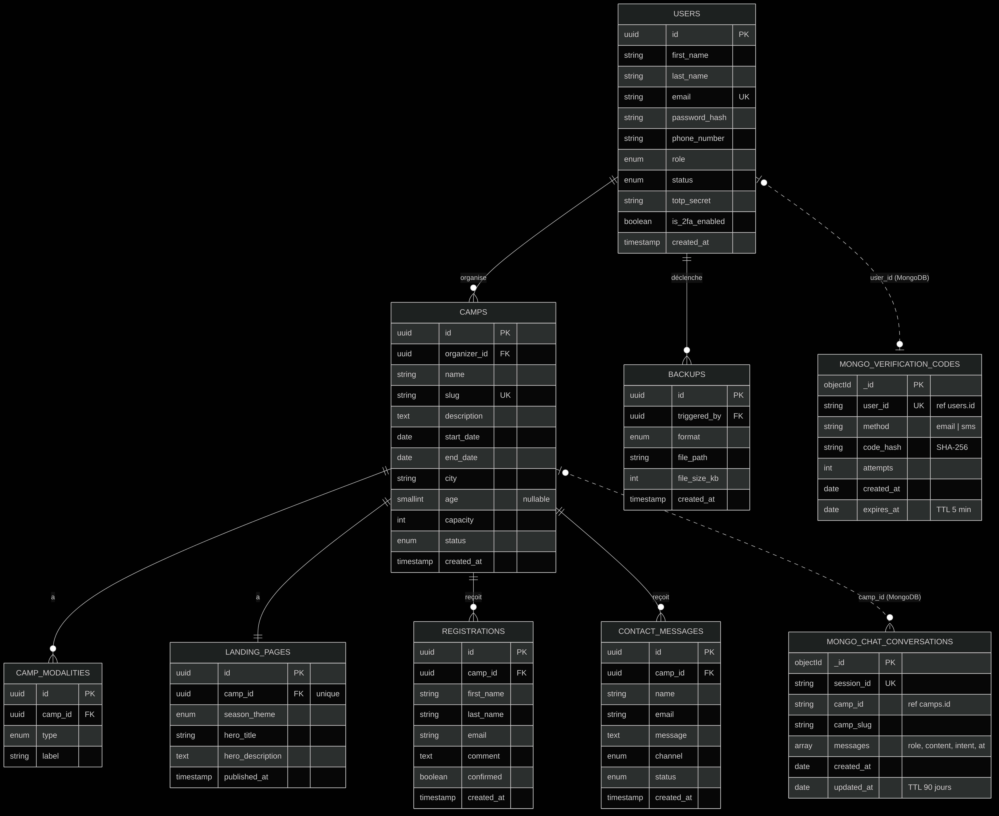

# 🏕️ CampOrga — Présentation complète du projet

**Auteur :** Thélyaan Dufrénoy (Lead Developer)
**Équipe :** Thélyaan Dufrénoy (Fullstack / Lead), Collins Odi Obi (Backend / DevOps + Frontend)
**Contexte :** Portfolio Project — Holberton School France
**Version :** 2.0.0 (fusion des branches `collins` et `tete-work`)
**Date :** Novembre 2026

---

## 📋 Sommaire

1. [Le problème](#1--le-problème)
2. [La solution](#2--la-solution)
3. [L'architecture technique](#3-️-larchitecture-technique)
4. [Le backend (API FastAPI)](#4--le-backend-api-fastapi)
5. [Le frontend (React)](#5--le-frontend-react)
6. [Les données (PostgreSQL + MongoDB)](#6-️-les-données-postgresql--mongodb)
7. [La sécurité](#7-️-la-sécurité)
8. [Les tests et la qualité](#8--les-tests-et-la-qualité)
9. [L'infrastructure](#9--linfrastructure)
10. [L'état d'avancement](#10--létat-davancement)
11. [La roadmap](#11-️-la-roadmap)
12. [Comment contribuer](#12--comment-contribuer)

---

## 1. 🎯 Le problème

Les équipes qui organisent des summer camps de code n'ont aujourd'hui **aucun outil centralisé** :
- Chaque camp est géré séparément (Excel, papier, emails).
- Aucune visibilité d'ensemble sur les camps de l'organisation.
- Le processus d'inscription n'est ni standardisé ni engageant.
- Les données sont dispersées et difficiles à sauvegarder.

**Conséquence :** perte de temps, erreurs de saisie, difficulté à suivre les inscriptions.

---

## 2. 💡 La solution

**CampOrga** est une plateforme web qui centralise tout :

- 🌐 **Landing page publique par camp** : thème de saison, compte à rebours, places restantes, âge minimum, partage LinkedIn.
- ✍️ **Inscription en ligne** des participants, sans compte.
- 💬 **Contact** : hotline (formulaire) et chatbot qui répond aux questions fréquentes ; les conversations sont conservées dans MongoDB.
- 📝 **Création de compte organisateur** : le compte reste en attente jusqu'à son activation par le super admin.
- 🗓️ **Gestion des camps** : dates, ville, âge minimum unique (`age`), capacité, modalités, statut.
- 📊 **Dashboard organisateur** : camps, inscriptions, présences, messages, statistiques du chatbot.
- 👥 **Administration** : utilisateurs, rôles, activation des comptes, backups SQL/CSV avec historique.
- 🔐 **Double authentification** TOTP et vérification par code email/SMS.

> Le **paiement** présent sur `tete-work` n'a pas été repris : il est hors du périmètre du MVP défini par le cahier des charges.

---

## 3. 🏗️ L'architecture technique

```text
┌──────────────┐   HTTP/JSON (JWT)   ┌──────────────────────────┐    SQL    ┌──────────────┐
│   Frontend   │ ──────────────────▶ │         Backend          │ ────────▶ │ PostgreSQL16 │
│ React + TS   │ ◀────────────────── │         FastAPI          │ ◀──────── │ users, camps │
│ (Vite :5173) │                     │  api/ → services/ → db   │           │ backups …    │
└──────────────┘                     └──────────────────────────┘           └──────────────┘
                                        │                 │
                                        │ pymongo         │ pg_dump / CSV
                                        ▼                 ▼
                                 ┌──────────────┐   ┌──────────────┐
                                 │  MongoDB 7   │   │  backend/    │
                                 │ chat, codes  │   │  backups/    │
                                 └──────────────┘   └──────────────┘
```

| Couche | Technologies |
|---|---|
| Frontend | React 19, TypeScript strict, Vite, Tailwind CSS 4, React Router 7, TanStack Query 5, React Hook Form + Zod 4 |
| Backend | Python 3.11, FastAPI, SQLAlchemy 2.0, Alembic, Pydantic v2 |
| Auth | JWT (HS256, claim `scope`), bcrypt, TOTP (pyotp + qrcode) |
| Bases de données | PostgreSQL 16 + MongoDB 7 |
| Infrastructure | Docker / Podman Compose, `camporga.sh` |
| Tests | Pytest + mongomock (127 tests, 97 %), Vitest (37 tests), Playwright, axe-core |

---

## 4. 🔌 Le backend (API FastAPI)

### Structure des dossiers

```text
backend/app/
├── api/          # Routes HTTP fines : elles valident, appellent un service, renvoient un schéma
├── services/     # Logique métier (camps, inscriptions, chat, 2FA, vérification, backups…)
│   └── permissions.py   # Règle commune : un camp n'est géré que par son organisateur ou le super admin
├── schemas/      # Validation Pydantic v2 (entrées et sorties)
├── models/       # Modèles SQLAlchemy (7 tables)
├── core/
│   ├── config.py      # Paramètres lus dans l'environnement
│   ├── security.py    # bcrypt + JWT (portées "access" et "2fa_pending")
│   ├── deps.py        # get_current_user, require_super_admin
│   └── exceptions.py  # Erreurs métier traduites en codes HTTP
├── db/           # Session PostgreSQL, connexion MongoDB + index
└── main.py       # Application, CORS, gestionnaire d'erreurs, /health, /ready
```

Les services lèvent des exceptions métier (`NotFoundError`, `ForbiddenError`, `ConflictError`…) que `main.py` convertit en réponses HTTP : les routes ne contiennent pas de logique.

### Endpoints

| Méthode | Route | Accès |
|---|---|---|
| `POST` | `/api/auth/login` | public |
| `POST` | `/api/auth/register` | public (compte créé inactif) |
| `POST` | `/api/auth/2fa/login` | jeton temporaire 2FA |
| `GET` | `/api/auth/me` | connecté |
| `POST` | `/api/auth/2fa/setup` · `enable` · `disable` | connecté |
| `POST` | `/api/auth/verify/send-email` · `send-sms` · `check-code` | connecté |
| `PATCH` · `DELETE` | `/api/users/me` | connecté |
| `GET` · `POST` | `/api/users` | super admin |
| `PATCH` | `/api/users/{id}/role` · `/api/users/{id}/status` | super admin |
| `DELETE` | `/api/users/{id}` | super admin |
| `GET` | `/api/public/camps` · `/api/camps/{slug}/public` | public |
| `GET` · `POST` | `/api/camps` | connecté |
| `GET` · `PATCH` · `DELETE` | `/api/camps/{id}` | organisateur du camp / super admin |
| `PUT` | `/api/camps/{id}/landing-page` | organisateur du camp / super admin |
| `POST` | `/api/camps/{slug}/registrations` | public |
| `GET` | `/api/camps/{id}/registrations` | organisateur du camp / super admin |
| `PATCH` | `/api/registrations/{id}/attendance` | organisateur du camp / super admin |
| `POST` | `/api/camps/{slug}/contact-messages` | public |
| `GET` | `/api/camps/{id}/contact-messages` | organisateur du camp / super admin |
| `PATCH` | `/api/contact-messages/{id}` | organisateur du camp / super admin |
| `POST` | `/api/camps/{slug}/chat` | public |
| `GET` | `/api/camps/{id}/chat/conversations` · `/chat/stats` | organisateur du camp / super admin |
| `GET` | `/api/dashboard/summary` | connecté |
| `GET` · `POST` | `/api/backups` | super admin |
| `GET` | `/api/backups/{id}/download` | super admin |
| `GET` | `/health` · `/ready` | public (supervision) |

**Documentation interactive :** `http://localhost:8000/docs` (Swagger UI)

---

## 5. 🖥️ Le frontend (React)

```text
frontend/src/
├── api/          # client.ts (fetch + JWT + erreurs), endpoints.ts, types.ts
├── auth/         # AuthContext (session, étape 2FA), RequireAuth (routes protégées)
├── components/   # ui, layouts, RegistrationForm, ContactForm, ChatWidget, CountdownTimer…
├── pages/
│   ├── HomePage, CampPage, LoginPage, RegisterPage, NotFoundPage
│   ├── organizer/   # DashboardPage, CampFormPage, CampManagePage, AccountPage
│   └── admin/       # UsersPage, BackupsPage
└── lib/          # campSchema (Zod), format (dates, âge), season (thèmes)
```

| Route | Page |
|---|---|
| `/` | Liste des camps publiés |
| `/camps/:slug` | Landing page d'un camp (inscription, contact, chatbot) |
| `/connexion` · `/inscription` | Connexion (avec étape code 2FA) · création de compte |
| `/espace` | Dashboard organisateur |
| `/espace/camps/nouveau` · `/espace/camps/:campId` · `…/modifier` | Création, gestion, modification d'un camp |
| `/espace/compte` | Profil, 2FA (QR code), vérification, suppression |
| `/espace/utilisateurs` · `/espace/sauvegardes` | Utilisateurs et sauvegardes (super admin) |

Les données serveur passent par TanStack Query (cache, invalidation après mutation) ; les formulaires sont validés côté client avec Zod puis côté serveur avec Pydantic.

---

## 6. 🗄️ Les données (PostgreSQL + MongoDB)



Détail : [`database-schema.sql`](./database-schema.sql) — source du diagramme : [`diagram_database.mmd`](./diagram_database.mmd).

**PostgreSQL — 7 tables**

```text
users (1) ──< (N) camps (1) ──< (N) registrations
  │                  ├──< (N) camp_modalities
  │                  ├──(1)── landing_pages
  │                  └──< (N) contact_messages
  └──< (N) backups
```

- **`users`** : comptes (super admin, organisateurs), téléphone, 2FA.
- **`camps`** : table centrale ; `age` = âge minimum (vide = tous âges).
- **`camp_modalities`** : inclus, options, critères d'éligibilité.
- **`landing_pages`** : page publique par camp (1-1).
- **`registrations`** : inscriptions des visiteurs, présence confirmée.
- **`contact_messages`** : messages hotline, statut non lu / lu / archivé.
- **`backups`** : historique des exports SQL/CSV.

**MongoDB — 2 collections**

- **`chat_conversations`** : une conversation par session de navigateur, messages imbriqués ; index TTL de 90 jours (RGPD).
- **`verification_codes`** : un code email/SMS par utilisateur, stocké haché ; index TTL à l'expiration (5 minutes).

**Intégrité :**
- Supprimer un camp supprime ses inscriptions, modalités, landing page et messages (cascade gérée par l'ORM).
- Un compte qui gère des camps ou a réalisé des sauvegardes ne peut pas être supprimé (409) ; `backups.triggered_by` est en `ON DELETE RESTRICT`.
- Les migrations Alembic font évoluer le schéma ; la migration `e7a1c3f90b21` fusionne `min_age`/`max_age` en `age` en convertissant les données existantes.

---

## 7. 🛡️ La sécurité

| Aspect | Implémentation |
|---|---|
| **Mots de passe** | bcrypt, 12 caractères minimum |
| **Sessions** | JWT HS256, expiration 60 min ; le claim `scope` sépare le jeton de session du jeton temporaire 2FA (5 min) |
| **2FA** | TOTP (Google/Microsoft Authenticator) ; désactivation soumise à un code valide |
| **Vérification** | Codes générés avec `secrets`, stockés en SHA-256, 5 essais max, expiration 5 min ; envoi simulé (code visible uniquement en développement) |
| **Accès** | Comptes inscrits inactifs jusqu'à validation ; un compte inactif ou désactivé est refusé |
| **Rôles** | `super_admin`, `sem`, `swe`, `ssm`, `dc`, `dt` (+ `organizer`, `admin`) |
| **Autorisations** | Un organisateur ne gère que ses camps ; administration réservée au super admin |
| **Validation** | Pydantic côté API, Zod côté interface ; requêtes SQL via l'ORM |
| **CORS** | Origines explicites (`CORS_ORIGINS`), en-tête `Content-Disposition` exposé |
| **Secrets** | Fichier `.env` hors Git, généré par `camporga.sh` ; MongoDB authentifié et exposé uniquement en local |
| **Backups** | `pg_dump` lancé sans shell ; chemin de fichier jamais exposé ; téléchargement limité au dossier des backups |

**Règles métier :**
- Le super admin ne peut être ni supprimé, ni rétrogradé, ni désactivé par lui-même.
- Les visiteurs n'ont pas de compte (inscriptions via `registrations`).

---

## 8. 🧪 Les tests et la qualité

**Backend — 127 tests Pytest, 97 % de couverture**

| Fichier | Tests | Sujet |
|---|---|---|
| `test_accounts.py` | 29 | Inscription, compte en attente, profil, suppression, 2FA, vérification |
| `test_business_rules.py` | 19 | Règles métier et autorisations |
| `test_camps.py` | 18 | CRUD des camps, filtres, âge |
| `test_auth.py` | 12 | Connexion, JWT, rôles |
| `test_chat.py` | 10 | Chatbot, conversations MongoDB, statistiques |
| `test_backups.py` | 9 | Export SQL/CSV, historique, téléchargement |
| `test_models.py` | 6 | Modèles |
| `test_health.py` | 4 | `/health`, `/ready`, CORS |
| `test_public_workflows.py` | 4 | Parcours visiteur complet |
| `test_registrations.py` | 4 | Inscriptions, présences, dashboard |

Les tests utilisent une base PostgreSQL dédiée (`camporga_test`) et `mongomock`.

**Frontend — 37 tests Vitest** (client API, formulaires, pages, utilitaires), plus `npm run typecheck` et `npm run lint`.

**Bout en bout :** scénario Playwright (inscription → compte en attente → activation → 2FA → connexion en 2 étapes → camp → suppression protégée → backups) et audit axe-core : 0 violation WCAG 2.1 AA.

```bash
./camporga.sh test
cd frontend && npm test
```

---

## 9. 🐳 L'infrastructure

**Docker Compose** orchestre 3 services ; le frontend tourne avec Vite :

| Service | Image | Port | Rôle |
|---|---|---|---|
| `db` | postgres:16-alpine | 5432 | Base relationnelle |
| `mongo` | mongo:7 | 127.0.0.1:27017 | Base documents (chat, codes) |
| `backend` | build local | 8000 | API FastAPI (migrations appliquées au démarrage) |
| frontend | Vite (`npm run dev`) | 5173 | Interface React |

**Script de gestion :** `camporga.sh`

```bash
./camporga.sh start          # Crée .env si besoin, démarre DB + Mongo + API
./camporga.sh admin          # Crée le super admin
./camporga.sh frontend       # Lance le frontend
./camporga.sh test           # Tests backend (base camporga_test)
./camporga.sh stop           # Arrête les services
./camporga.sh cleanup        # Détruit conteneurs et volumes
```

**Accès :** API `http://localhost:8000` · Swagger `http://localhost:8000/docs` · Frontend `http://localhost:5173`

---

## 10. 📊 L'état d'avancement

| Composant | Statut |
|---|---|
| Backend (FastAPI, architecture en couches) | ✅ |
| Bases de données (PostgreSQL + MongoDB, migrations Alembic) | ✅ |
| Authentification (JWT + 2FA + vérification email/SMS simulée) | ✅ |
| Frontend React (public, organisateur, administration) | ✅ |
| Tests (127 backend, 37 frontend, e2e, accessibilité) | ✅ |
| Documentation (README, schéma, diagramme, CHANGELOG) | ✅ |
| Outil d'audit (`scripts/compat_evaluator.py`) | ✅ |
| Intégration continue (GitHub Actions) | ⏳ À venir |
| Déploiement en ligne | ⏳ À venir |

---

## 11. 🗺️ La roadmap

### Court terme
- Intégration continue (tests backend + frontend à chaque push).
- Déploiement en ligne (frontend statique + API + bases managées).
- Envoi réel des emails et SMS de vérification.

### Moyen terme
- Remplacer le chatbot par intentions par une vraie API LLM.
- Cache Redis pour les pages publiques.
- Backups vers un stockage objet (S3/MinIO).

### Long terme
- Scalabilité horizontale : voir [`scalability-roadmap.md`](./scalability-roadmap.md).
- Multi-langue (FR/EN).
- Recommandation de camps par Machine Learning.

---

## 12. 🤝 Comment contribuer

### Prérequis
- Docker (ou Podman) avec Compose.
- Node.js 20+ (frontend).
- Python 3.11+ (optionnel, hors conteneur).

### Workflow Git
- `main` : branche stable.
- `dev` : branche d'intégration (contient la fusion 2.0.0).
- `feature/*` : une branche par tâche.

### Convention de commits
- `feat:` nouvelle fonctionnalité · `fix:` correction · `docs:` documentation · `test:` tests · `chore:` divers.

### Avant chaque commit
```bash
./camporga.sh test
cd frontend && npm test && npm run lint
```

---

## 📎 Annexes

- **Repo GitHub :** `https://github.com/BlackGhostMatrixx555/holbertonschool-portfolio`
- **Branche d'intégration :** `dev`
- **Documentation technique :** [`stage3-technical-documentation.pdf`](./stage3-technical-documentation.pdf)
- **Cahier des charges :** [`cahier-des-charges.pdf`](./cahier-des-charges.pdf)
- **Roadmap de scalabilité :** [`scalability-roadmap.md`](./scalability-roadmap.md)
- **Historique des versions :** [`CHANGELOG.md`](./CHANGELOG.md)
